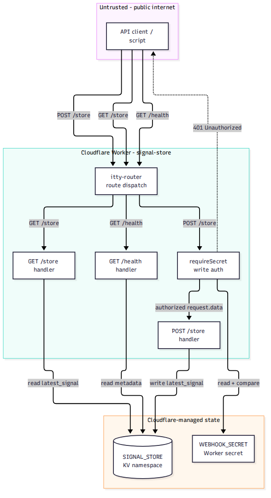
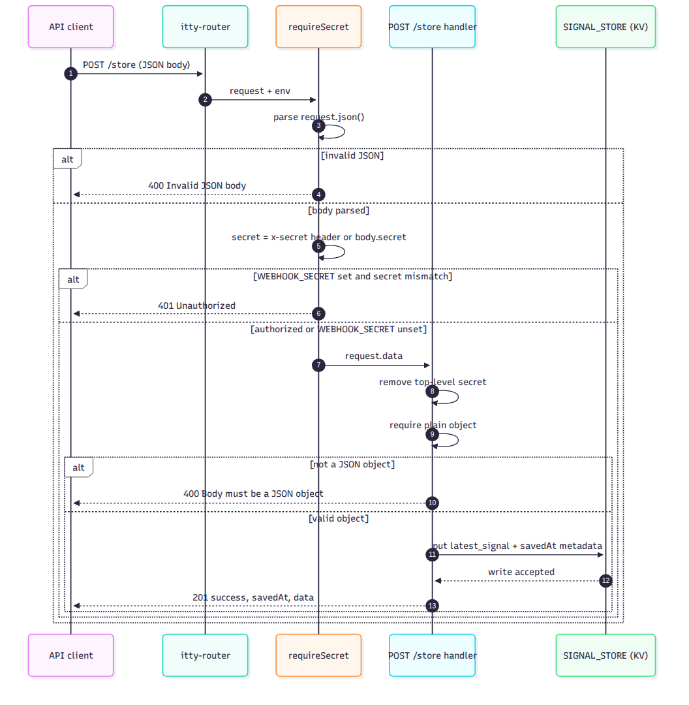
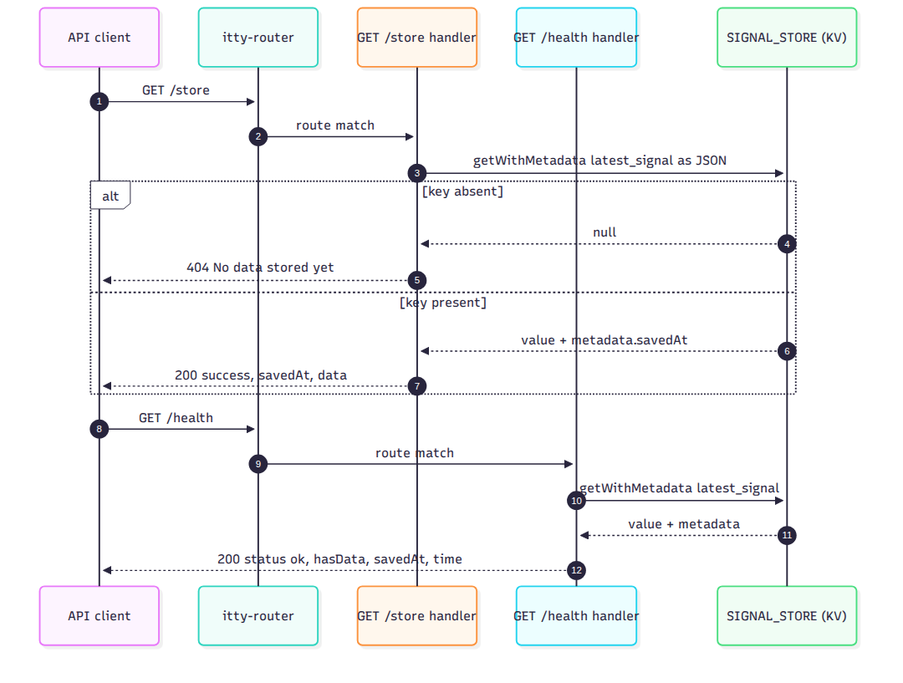
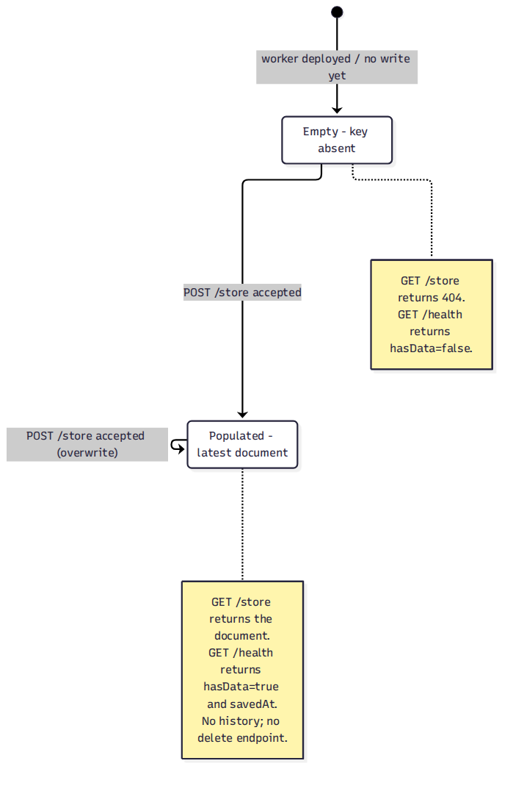
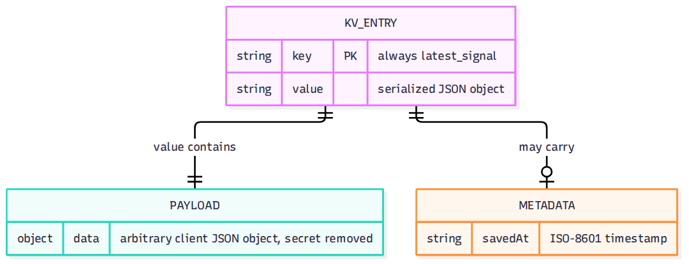

# signal-store

A tiny Cloudflare Worker that stores one JSON document in Cloudflare KV and
serves the latest value over HTTP. It is intended for small scripts,
automations, and status feeds that need a shared "latest signal" without a
database server.

## Endpoints

| Method | Path | Auth | Purpose |
| --- | --- | --- | --- |
| `POST` | `/store` | Shared secret when `WEBHOOK_SECRET` is configured | Replace the latest JSON object. |
| `GET` | `/store` | None | Return the latest JSON object. |
| `GET` | `/health` | None | Report reachability and whether data exists. |

The Worker stores the document under the fixed KV key `latest_signal` and keeps
a `savedAt` timestamp in KV metadata. Writes are last-write-wins; there is no
history or delete endpoint.

## Architecture at a glance

These images are rendered from the Mermaid sources in
[docs/design.md](docs/design.md). Each image is capped at 1080 x 1080 pixels.

<a href="docs/diagrams/system-context.png">
  
</a>

<table>
  <tr>
    <td width="50%" valign="top">
      <a href="docs/diagrams/write-path.png">
        
      </a>
      <br /><sub><b>Write path</b> - auth, validation, and KV write.</sub>
    </td>
    <td width="50%" valign="top">
      <a href="docs/diagrams/read-paths.png">
        
      </a>
      <br /><sub><b>Read paths</b> - document and health reads.</sub>
    </td>
  </tr>
  <tr>
    <td width="50%" valign="top">
      <a href="docs/diagrams/data-lifecycle.png">
        
      </a>
      <br /><sub><b>KV lifecycle</b> - empty, populated, overwrite.</sub>
    </td>
    <td width="50%" valign="top">
      <a href="docs/diagrams/stored-record.png">
        
      </a>
      <br /><sub><b>Stored record</b> - singleton key, payload, and metadata.</sub>
    </td>
  </tr>
</table>

## Requirements

- Node.js 18 or newer for Wrangler.
- A Cloudflare account with Workers and KV enabled.
- Wrangler, installed as a project dependency.

## Setup

1. Install dependencies:

   ```bash
   npm install
   ```

2. Create the KV namespace:

   ```bash
   npx wrangler kv namespace create SIGNAL_STORE
   ```

3. Copy the returned namespace `id` into `wrangler.toml` under the
   `[[kv_namespaces]]` block. The binding name must remain `SIGNAL_STORE`.

4. Set the write secret. Do not put the value in `wrangler.toml`:

   ```bash
   npx wrangler secret put WEBHOOK_SECRET
   ```

5. Run locally:

   ```bash
   npm run dev
   ```

6. Deploy:

   ```bash
   npm run deploy
   ```

## Configuration

| Name | Type | Required | Description |
| --- | --- | --- | --- |
| `SIGNAL_STORE` | KV binding | Yes | Namespace that stores the `latest_signal` key. |
| `WEBHOOK_SECRET` | Worker secret | Recommended | Shared secret for `POST /store`. |

`WEBHOOK_SECRET` can be supplied as the `x-secret` request header or as the
top-level `secret` field in the JSON body. The body field is removed before the
payload is stored.

## Usage

### Write the latest document

```bash
curl -X POST https://<worker-host>/store \
  -H 'content-type: application/json' \
  -H 'x-secret: <your-secret>' \
  -d '{"status":"ok","message":"hello"}'
```

Response:

```json
{
  "success": true,
  "savedAt": "2026-10-20T12:34:56.789Z",
  "data": {
    "status": "ok",
    "message": "hello"
  }
}
```

### Read the latest document

```bash
curl https://<worker-host>/store
```

Response when data exists:

```json
{
  "success": true,
  "savedAt": "2026-10-20T12:34:56.789Z",
  "data": {
    "status": "ok",
    "message": "hello"
  }
}
```

When no document exists, the endpoint returns `404` with
`{"error":"No data stored yet"}`.

### Health check

```bash
curl https://<worker-host>/health
```

Response:

```json
{
  "status": "ok",
  "hasData": true,
  "savedAt": "2026-10-20T12:34:56.789Z",
  "time": "2026-10-20T12:35:01.000Z"
}
```

If no document exists, `hasData` is `false` and `savedAt` is `null`.

## Security and operational notes

- `GET /store` is currently public and returns the stored payload. Do not store
  secrets or sensitive data unless read access is added.
- Write auth fails open when `WEBHOOK_SECRET` is missing or empty. Set the secret
  in production.
- The top-level `secret` field is stripped before storage; nested fields are not.
- KV is eventually consistent. A read immediately after a write may return the
  previous value.
- Concurrent writes are last-write-wins.
- The Worker does not set CORS headers, rate-limit requests, or enforce a
  payload size beyond Cloudflare's platform limits.
- KV errors are not currently converted into a stable JSON error response.

See [docs/design.md](docs/design.md) for the full risk assessment.

## Development

```bash
npm run dev      # local Worker with Wrangler
npm run deploy   # deploy to Cloudflare
```

There is no automated test suite yet. The intended test harness, cases, and
smoke checklist are documented in [docs/test.md](docs/test.md); the hardening
plan is in [docs/plan.md](docs/plan.md).

## Project structure

```text
.
├── README.md
├── docs/
│   ├── diagrams/
│   │   ├── data-lifecycle.png
│   │   ├── read-paths.png
│   │   ├── stored-record.png
│   │   ├── system-context.png
│   │   └── write-path.png
│   ├── intent.md
│   ├── design.md
│   ├── plan.md
│   └── test.md
├── package.json
├── src/
│   └── index.js
└── wrangler.toml
```

## Documentation

- [Intent](docs/intent.md): problem, outcome, constraints, and open questions.
- [Design](docs/design.md): requirements, Mermaid diagrams, API contracts,
  architecture assessment, and known gaps.
- [Plan](docs/plan.md): ordered hardening and verification phases.
- [Test](docs/test.md): test strategy, matrix, commands, and smoke checklist.
