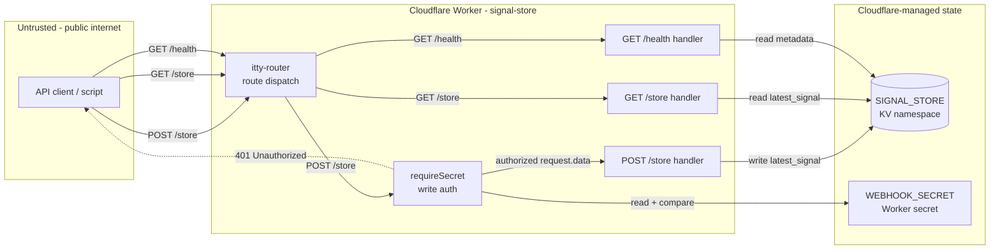
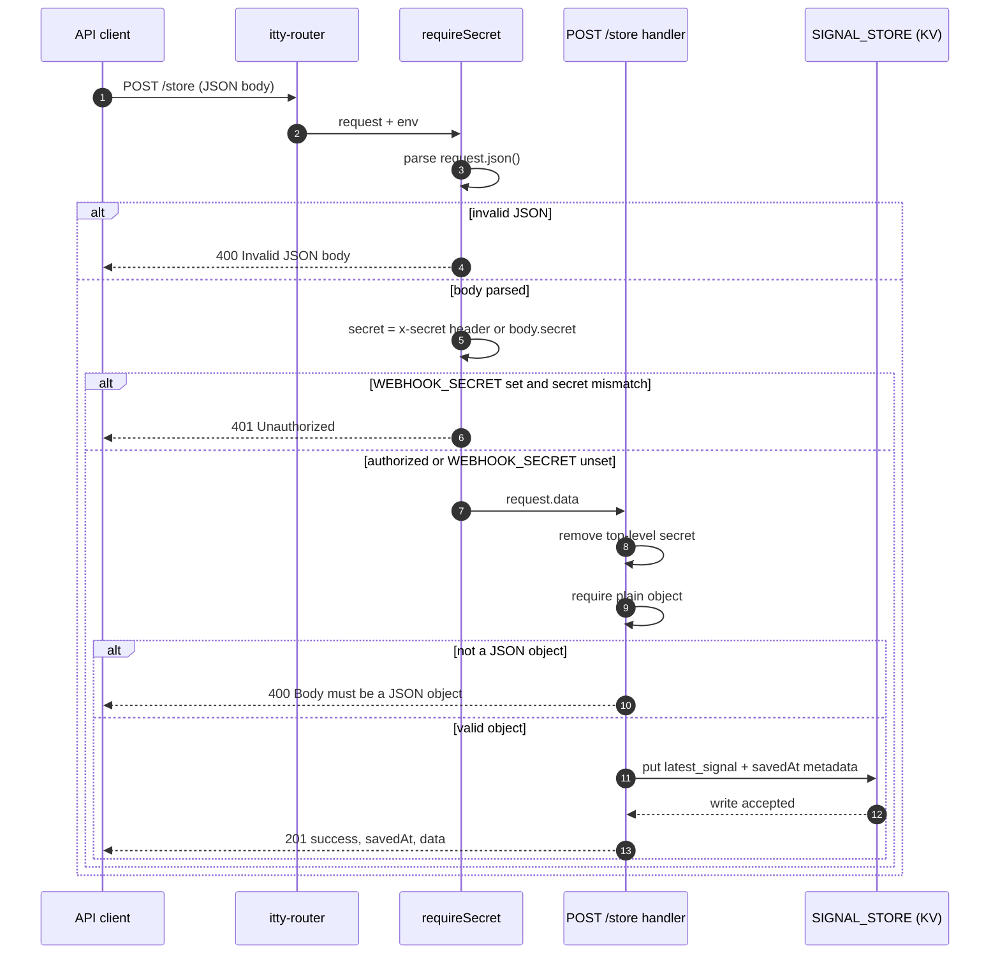
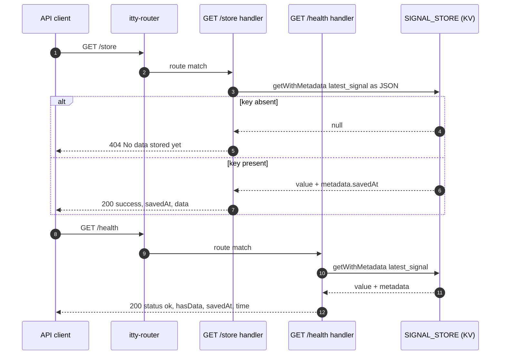
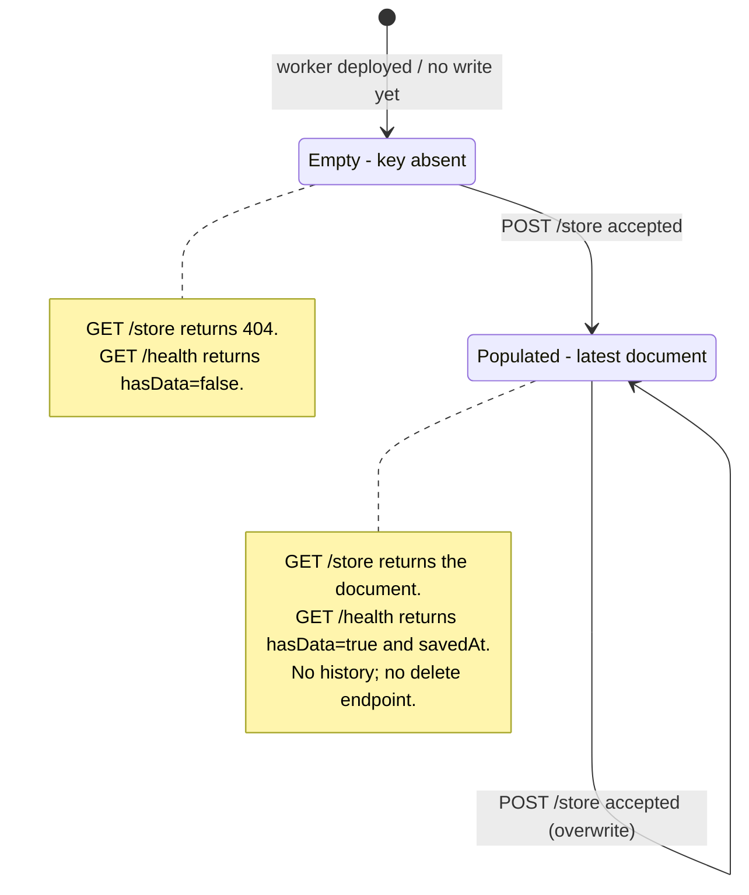
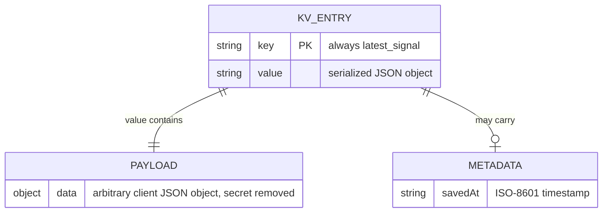

# Design: signal-store

Status: baseline, reverse-documented from the current implementation
Last updated: 2026-10-20
Related: [intent.md](intent.md), [plan.md](plan.md), [test.md](test.md)

## 1. Scope and requirements

`signal-store` is a single Cloudflare Worker backed by one Cloudflare KV key. It
accepts one JSON document, stores the latest value, and serves that value plus a
small health response.

### Functional requirements

| ID | Requirement | Current implementation |
| --- | --- | --- |
| FR-1 | Accept a JSON object and replace the latest stored document. | `POST /store` in `src/index.js:56` |
| FR-2 | Return the latest stored document. | `GET /store` in `src/index.js:76` |
| FR-3 | Report reachability and whether data exists. | `GET /health` in `src/index.js:44` |
| FR-4 | Protect writes with a shared secret when configured. | `requireSecret` in `src/index.js:27` |
| FR-5 | Persist one document without a database server. | KV binding `SIGNAL_STORE`, key `latest_signal` |
| FR-6 | Return a stable JSON error for unknown routes. | Catch-all in `src/index.js:93` |

### Non-functional requirements

| ID | Requirement | Status |
| --- | --- | --- |
| NFR-1 | Low-latency, globally available reads. | Partially met by Workers + KV; reads are eventually consistent. |
| NFR-2 | Durable storage across Worker deployments. | Met by Cloudflare KV. |
| NFR-3 | Writes must not be possible without authorization in production. | Not met when `WEBHOOK_SECRET` is unset or empty. |
| NFR-4 | Stored data must not be readable by unauthorized callers. | Not met: `GET /store` is public. |
| NFR-5 | Failures from KV must produce a predictable API response. | Not met: KV exceptions are unhandled. |
| NFR-6 | Operational visibility for write and failure events. | Not met: no structured logging. |
| NFR-7 | No build step; deploy directly with Wrangler. | Met. |

### Out of scope

Multi-document storage, history, rollback, user accounts, per-client credentials,
schema validation beyond a top-level object, notifications, analytics, and
cross-region read-after-write guarantees.

## 2. Architecture diagrams

### 2.1 System context: who talks to whom

This diagram shows runtime components and trust boundaries. It deliberately omits
handler internals and request schemas.



Key observations:

- The only trust boundary is between the public client and the Worker. The
  Worker-to-KV path is inside Cloudflare's managed boundary.
- Auth sits only on the write path. Reads bypass `requireSecret`.
- The Worker has one external state dependency: the `SIGNAL_STORE` KV namespace.
- The body-field secret is part of the request contract, but it is removed
  before persistence.

### 2.2 Write path: `POST /store`

Question answered: what happens, in what order, when a client writes?



Implementation note: the object check currently runs after the body has been
spread into `data`. As a result, JSON strings, numbers, booleans, and arrays can
be coerced into objects, and a JSON `null` body can throw. See
[Known gaps](#8-known-gaps-and-risks).

### 2.3 Read paths: `GET /store` and `GET /health`

Question answered: what happens when a client reads the document or asks for
health?



Both read paths are unauthenticated. `GET /health` returns `hasData: false` and
`savedAt: null` when the key is absent; it does not return 404 in that case.

### 2.4 KV entry lifecycle

Question answered: how does the stored document change state?



There is no application-level transition back to `Empty`. Deleting the KV key or
the namespace is an out-of-band operator action.

### 2.5 Stored record model

Question answered: what data entities exist?



## 3. API contracts

All responses are JSON. The Worker does not set CORS headers.

### 3.1 `POST /store`

Auth: required only when `WEBHOOK_SECRET` is configured. Supply the secret as
`x-secret: <secret>` or as the top-level `secret` field in the JSON body.

Request body: a JSON object. The top-level `secret` field is removed before
storage.

Success, `201 Created`:

```json
{
  "success": true,
  "savedAt": "2026-10-20T12:34:56.789Z",
  "data": {
    "example": "value"
  }
}
```

Error responses:

| Status | Body | Condition |
| --- | --- | --- |
| 400 | `{"error":"Invalid JSON body"}` | The request body cannot be parsed as JSON. |
| 401 | `{"error":"Unauthorized"}` | `WEBHOOK_SECRET` is set and the supplied secret does not match. |
| 400 | `{"error":"Body must be a JSON object"}` | Intended for non-object payloads; currently not reliably enforced. |
| 500 | Platform error response | KV throws, or a `null` body reaches destructuring. |

Content type is not enforced; any body that `request.json()` accepts is parsed.

### 3.2 `GET /store`

Auth: none.

Success, `200 OK`:

```json
{
  "success": true,
  "savedAt": "2026-10-20T12:34:56.789Z",
  "data": {
    "example": "value"
  }
}
```

`savedAt` is `null` if the KV entry has no metadata.

Error responses:

| Status | Body | Condition |
| --- | --- | --- |
| 404 | `{"error":"No data stored yet"}` | The `latest_signal` key is absent. |
| 500 | Platform error response | KV throws or returns an invalid JSON value. |

### 3.3 `GET /health`

Auth: none.

Success, `200 OK`:

```json
{
  "status": "ok",
  "hasData": true,
  "savedAt": "2026-10-20T12:34:56.789Z",
  "time": "2026-10-20T12:35:01.000Z"
}
```

When no document exists, `hasData` is `false` and `savedAt` is `null`.

Error responses:

| Status | Body | Condition |
| --- | --- | --- |
| 500 | Platform error response | KV throws. |

### 3.4 Unknown routes

Any unmatched method and path returns `404` with:

```json
{
  "error": "Not found"
}
```

## 4. Data ownership and state

- **Owner of persisted data:** the `SIGNAL_STORE` KV namespace.
- **Key:** `latest_signal`, a single fixed key.
- **Value:** `JSON.stringify(data)`, where `data` is the client payload with the
  top-level `secret` field removed.
- **Metadata:** `{ "savedAt": "<ISO-8601 timestamp>" }`.
- **Access path:** only through `env.SIGNAL_STORE`; there is no other data store.
- **Write granularity:** one key per write. The write is atomic at the key level.
- **Concurrency:** last write wins; there is no version check, ETag, or CAS.
- **Retention:** no TTL and no history; the latest value remains until overwritten
  or deleted out of band.
- **Consistency:** Cloudflare KV is eventually consistent across locations, so a
  read immediately after a write may return the previous value.

## 5. Trust boundaries and failure modes

The untrusted internet talks directly to the Worker. `POST /store` crosses an
auth check; `GET /store` and `GET /health` do not. The Worker crosses into
Cloudflare-managed KV on every route.

| Dependency or condition | Current behavior | Design concern |
| --- | --- | --- |
| Invalid JSON body | `400 Invalid JSON body` | Handled in `requireSecret`. |
| Missing or wrong secret, secret configured | `401 Unauthorized` | Handled, but comparison is not constant-time. |
| `WEBHOOK_SECRET` unset or empty | Writes are accepted without auth | Fail-open; production risk. |
| Non-object JSON payload | May be coerced and stored, or throw | Validation runs after spreading; bug. |
| KV key absent | `GET /store` returns 404; health reports `hasData:false` | Handled. |
| KV timeout or exception | Unhandled exception, generic 500 | No stable error contract or retry. |
| Concurrent writes | Last write wins | No coordination or conflict signal. |
| Read immediately after write | May observe stale value | KV eventual consistency. |
| Oversized request | Cloudflare platform limit | No explicit application limit or error. |
| Cross-origin browser request | No CORS headers | Browser clients cannot read responses directly. |
| Secret comparison | String `!==` | Timing side channel; low practical risk, but not constant-time. |
| Secret placement | Header or body | Body secrets may be captured by request logging. |

## 6. Architecture assessment

This assessment is based on the diagrams above and the current source in
`src/index.js`.

### 6.1 Requirements alignment

- [x] FR-1 write maps to the `C -> R -> A -> SW -> KV` path in 2.1 and 2.2.
- [x] FR-2 read maps to the `C -> R -> SR -> KV` path in 2.1 and 2.3.
- [x] FR-3 health maps to the `C -> R -> HH -> KV` path in 2.1 and 2.3.
- [x] FR-4 write auth maps to `A -> SEC` in 2.1 and the auth branch in 2.2.
- [x] FR-5 single-document persistence maps to the single key in 2.4 and 2.5.
- [x] FR-6 unknown routes map to the catch-all in `src/index.js:93`.
- [ ] NFR-3 write authorization is not guaranteed when the secret is absent.
- [ ] NFR-4 read authorization is not implemented.
- [ ] NFR-5 KV failure behavior is not defined.
- [x] NFR-1 latency is addressed by edge execution; consistency is an explicit
  trade-off, not an oversight.

### 6.2 Structural integrity

- No circular dependencies: the context flow is acyclic, and handlers do not call
  back into the router or auth middleware.
- Auth is isolated in `requireSecret`; changing the secret policy is a
  one-function change.
- The payload is treated as opaque data, so payload-shape changes are confined to
  clients.
- Storage is not behind a repository abstraction. Both store handlers and the
  health handler call `env.SIGNAL_STORE` directly, so a storage change touches
  three handlers.
- Responsibilities are separated by route: write validation belongs to the POST
  handler, read formatting to the GET handler, and health reporting to the health
  handler.

### 6.3 Data and state

- Data ownership is unambiguous: one KV namespace, one key.
- The only path to persistent storage is the `SIGNAL_STORE` binding.
- Transaction boundaries are the individual `put`; no multi-key transaction is
  possible or needed.
- There is no concurrency control. The design accepts last-write-wins.
- There is no data migration or schema version, because the payload shape is
  intentionally opaque.

### 6.4 Interfaces and integration

- The only external dependency is Cloudflare KV. Its failure mode is currently
  an unhandled exception, which becomes a generic 500.
- API contracts are defined in section 3, including error responses.
- The trust boundary is marked in 2.1. Sensitive data crossing it includes the
  shared secret on writes and the stored payload on reads.
- CORS is not configured, which limits browser-based consumers.
- No rate limiting or per-client quota protects KV or the shared secret.

### 6.5 Change-volatility check

| Likely change | Blast radius | Containment |
| --- | --- | --- |
| Payload shape or fields | Clients only | Worker stores the object opaquely. |
| Auth policy (header-only, fail-closed) | `requireSecret` and its tests | Isolated in one function. |
| Storage backend (KV to D1/R2) | Both store handlers + health handler | No repository boundary; currently leaky. |
| Additional endpoint | Router wiring | Handlers are independent. |
| Read authorization | Router or handler guard | Not yet designed; would add a new edge/check. |
| Response format | Handlers and clients | JSON contract is small. |

The most volatile concern is the auth/read policy, because it changes the trust
boundary rather than only an implementation detail. It should be decided before
the next feature that stores sensitive data.

### 6.6 Diagram sanity

- Five diagrams, each answering one question: context, write sequence, read
  sequence, state lifecycle, and data model.
- Primary element counts: context 8, write sequence 5, read sequence 5, state 2,
  data model 3.
- Every edge is labeled; no unlabeled arrows or miscellaneous boxes.
- Abstraction levels are not mixed: runtime components appear only in 2.1,
  interactions only in 2.2-2.3, and data entities only in 2.5.
- External dependency and data store are shown explicitly in 2.1.
- Mermaid blocks use standard `flowchart`, `sequenceDiagram`, `stateDiagram-v2`,
  and `erDiagram` syntax. They should be rendered in CI or a Markdown preview
  after changes.

## 7. Baseline decisions (ADR-lite)

These are reverse-documented decisions inferred from the current implementation.
They are not claims about a formal historical approval.

### D-001: Store one document under a fixed KV key

**Context:** The product needs the latest signal, not a collection of records.

**Decision:** Use one KV key, `latest_signal`, and overwrite it on each write.

**Consequences:** Reads and writes are simple and cheap; there is no history,
query capability, or conflict detection. Rejected alternative: one key per
document plus a separate index.

### D-002: Require a shared secret on writes only

**Context:** Publishing should be gated, while reading should stay simple for
dashboards and scripts.

**Decision:** Apply `requireSecret` to `POST /store` only. Accept the secret in
`x-secret` or the top-level body field.

**Consequences:** Readers need no credentials; stored data is public unless a
separate access control layer is added. When `WEBHOOK_SECRET` is absent, writes
are also public. Rejected alternative: auth on every route.

### D-003: Use plain ESM and itty-router with no build step

**Context:** The Worker is small and should deploy directly.

**Decision:** Write ESM JavaScript, use `itty-router` v5, and deploy with
Wrangler without a bundler.

**Consequences:** Fast deploy and a small toolchain; no static types or
compile-time checks, and no test runner is configured yet. Rejected alternative:
TypeScript plus a bundler.

### D-004: Access KV directly from handlers

**Context:** There are only three routes and one storage key.

**Decision:** Call `env.SIGNAL_STORE` from the route handlers instead of adding a
repository layer.

**Consequences:** Fewer files and less indirection; KV-specific code is spread
across the store and health handlers. Revisit if a second storage backend,
multiple documents, or schema versioning is introduced.

## 8. Known gaps and risks

Ordered roughly by security and correctness impact.

1. **Fail-open write auth.** `requireSecret` skips the check when
   `WEBHOOK_SECRET` is unset or empty (`src/index.js:36`). A misconfigured
   deployment accepts unauthenticated writes.
2. **Public reads.** `GET /store` returns the stored payload without auth
   (`src/index.js:76`). The commented-out protected version at
   `src/index.js:72-74` suggests this may have been intentional as a temporary
   choice.
3. **Ineffective object validation.** The body is spread before the object check
   (`src/index.js:57-61`). JSON strings, numbers, booleans, and arrays can become
   objects; a `null` body can throw. Desired behavior is a `400` for every
   non-object payload.
4. **Unhandled KV failures.** KV exceptions are not caught, so clients receive a
   generic 500 rather than a stable JSON error. The health endpoint also depends
   on KV, so it fails when KV fails.
5. **No automated tests.** There is no test script or test directory. The
   behaviors above are unprotected against regression.
6. **Last-write-wins.** Concurrent writers overwrite each other without warning.
7. **Eventual consistency.** A read immediately after a write can return stale
   data.
8. **No rate limiting or payload limit.** Platform limits are the only backstop.
9. **No CORS.** Browser-based consumers cannot call the API cross-origin.
10. **No structured logs or request IDs.** Auth failures and KV errors are not
    observable beyond platform logs.
11. **Non-constant-time secret comparison.** `!==` is used in
    `src/index.js:36`.

## 9. Out of scope for this design

- A multi-document data model.
- Authentication for reads, until the intent question is resolved.
- A repository abstraction or storage migration.
- TypeScript, bundling, and a frontend.
- Audit logging, history, and rollback.
